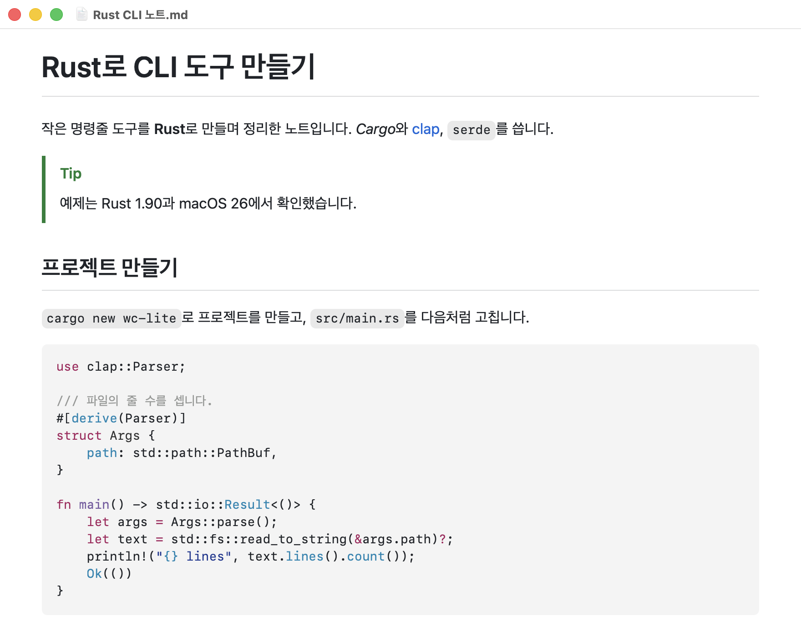
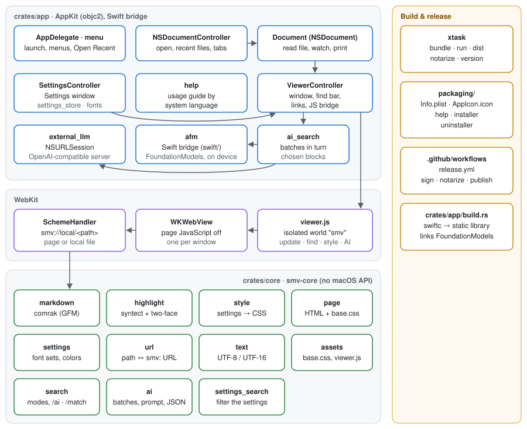
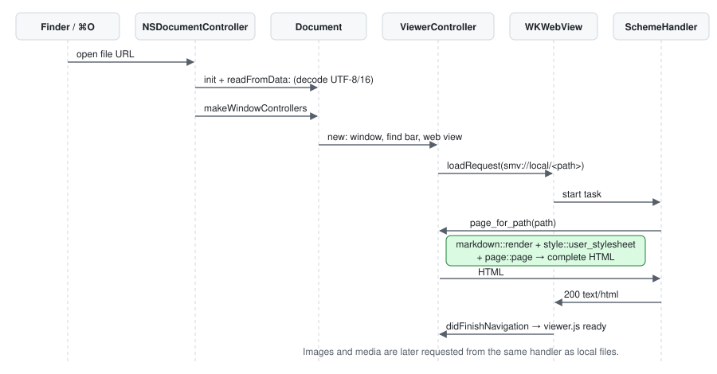
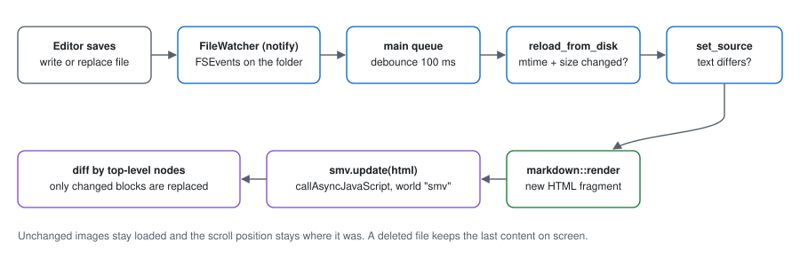
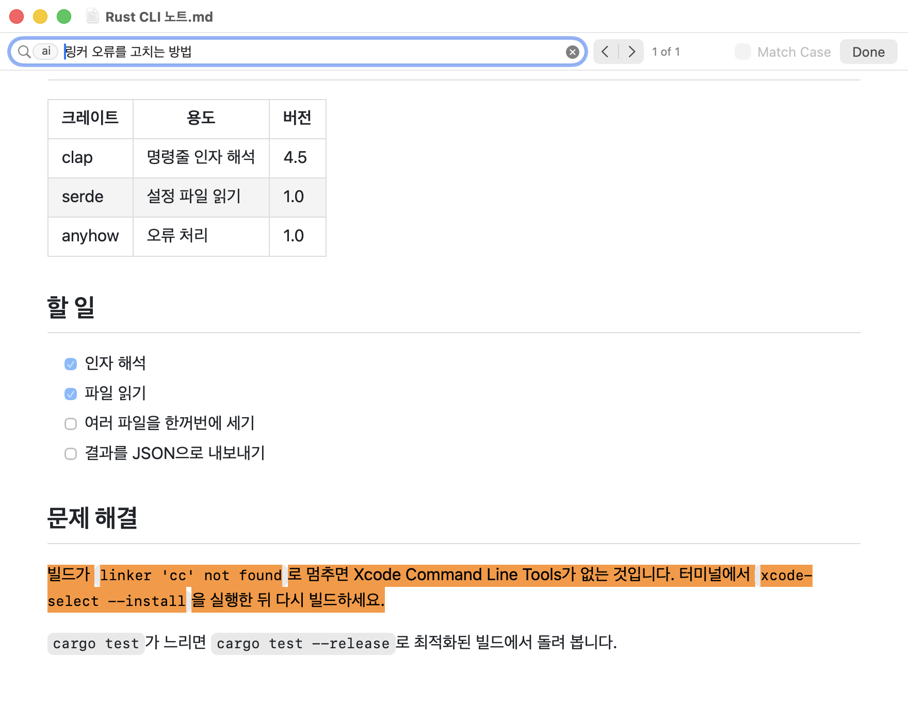
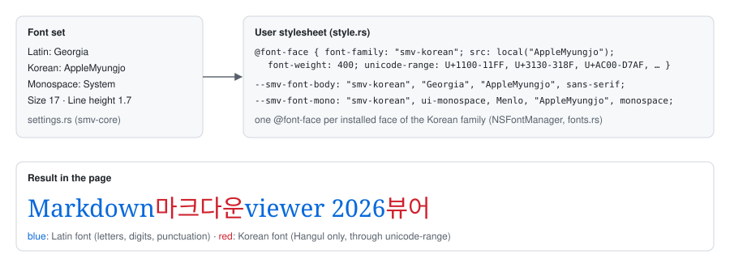
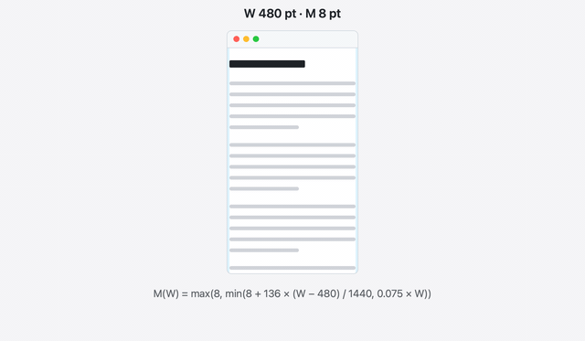
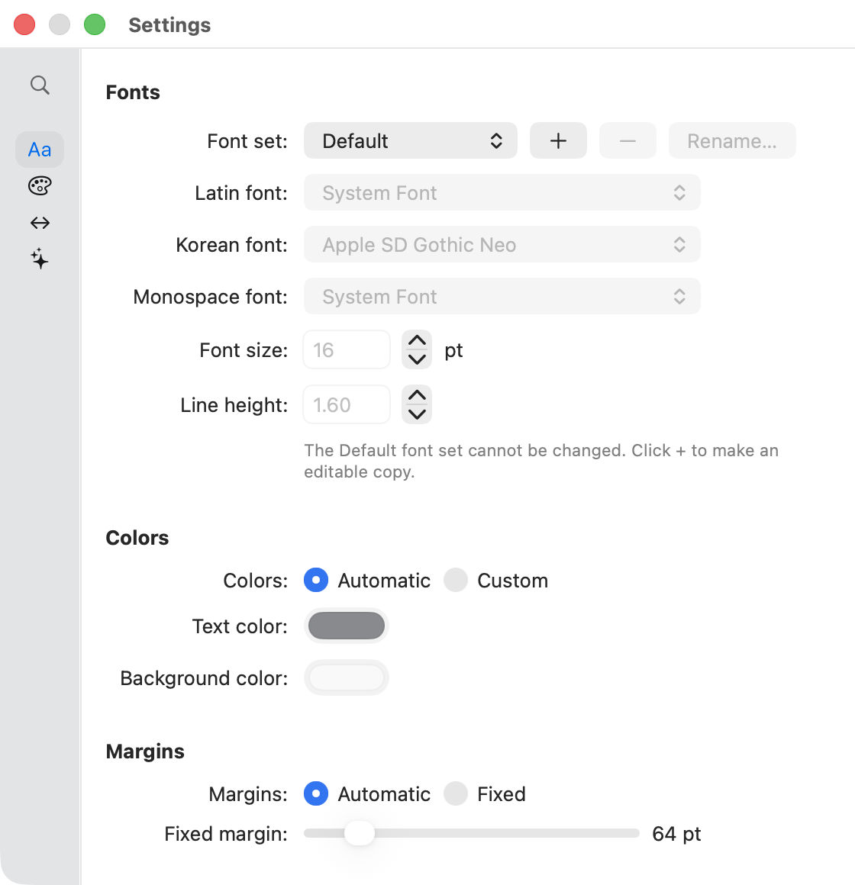
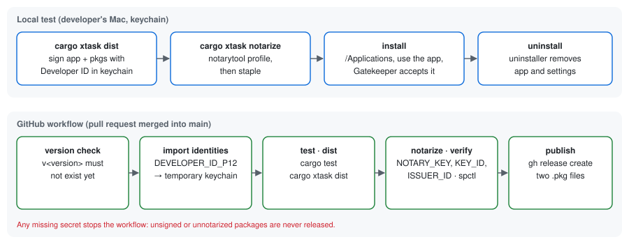

# skon's Markdown Viewer 아키텍처

이 문서는 앱이 어떻게 동작하는지 설명합니다. 무엇을 해야 하는지는 [명세(spec/STANDARD.md)](../spec/STANDARD.md)가 정하고, 이 문서는 그것을 어떻게 구현했는지를 다룹니다. 두 문서가 다르면 명세가 맞습니다.

## 1. 한눈에 보기



- **언어**: Rust로 씁니다. AppKit·WebKit은 [objc2](https://github.com/madsmtm/objc2) 바인딩으로 직접 호출합니다. Swift에서만 쓸 수 있는 Foundation Models 프레임워크(AI 검색)만 작은 Swift 파일로 감싸 C 함수로 부릅니다(§7, §13). Objective-C 코드는 없습니다.
- **앱 구조**: 문서 기반 AppKit 앱입니다. Markdown 파일 하나가 `NSDocument` 하나이고, 창마다 `WKWebView`가 하나씩 있습니다.
- **렌더링**: Markdown → HTML 변환([comrak](https://github.com/kivikakk/comrak))과 코드 하이라이트([syntect](https://github.com/trishume/syntect))는 Rust에서 하고, 화면 표시는 WebKit이 합니다.
- **설정 반영**: 글꼴·색·여백 설정은 CSS로 바꿔 페이지에 넣습니다.
- **AI 검색**: 문서의 블록을 묶음으로 나눠 Mac 안의 Apple Foundation Model이나 OpenAI 호환 외부 LLM에 차례로 보내고, 모델이 고른 블록을 강조합니다. 임베딩·색인·데이터베이스는 쓰지 않습니다.



## 2. 저장소 구조

```
Cargo.toml                 워크스페이스 (버전은 여기서 관리)
.cargo/config.toml         대상 aarch64-apple-darwin, MACOSX_DEPLOYMENT_TARGET=26.0, `cargo xtask` 별칭
crates/core/               smv-core: macOS API를 쓰지 않는 부분 (단위 테스트 대상)
  src/markdown.rs          Markdown → HTML (comrak 옵션)
  src/highlight.rs         코드 블록 하이라이트 (syntect + two-face 문법 모음)
  src/style.rs             설정 → 사용자 스타일시트(CSS)
  src/settings.rs          설정 모델과 규칙 (글꼴 세트, 색, 여백, 확대, AI 모델)
  src/settings_search.rs   설정 창 검색의 거르기
  src/page.rs              페이지 HTML 틀
  src/url.rs               파일 경로 ↔ smv: URL, HTTP Range 해석
  src/text.rs              UTF-8/UTF-16 해석
  src/search.rs            검색 방식과 명령(`/ai` 등) 해석
  src/ai.rs                AI 검색: 묶음 나누기, 토큰 어림, 프롬프트, 외부 LLM 요청·응답
  assets/base.css          기본 스타일시트 (GitHub 스타일)
  assets/viewer.js         페이지 안에서 도는 유일한 스크립트
crates/app/                markdown-viewer: macOS 앱 (실행 파일 MarkdownViewer)
  build.rs                 Swift 브리지 컴파일과 링크
  swift/                   Foundation Models 프레임워크를 C 함수로 감싼 Swift 코드
xtask/                     빌드 도구: 앱 번들, pkg, 공증
packaging/                 Info.plist, 아이콘(AppIcon.icon), Help 문서, 설치·제거 pkg 자료
.github/workflows/         릴리스 워크플로
spec/                      명세와 명세 요청서
doc/                       이 문서와 논의 사항
```

## 3. 시작과 문서 열기

1. `main.rs`는 문서 클래스 `SMVDocument`를 Objective-C 런타임에 먼저 등록합니다. `NSDocumentController`가 Info.plist의 `NSDocumentClass` 이름으로 클래스를 찾기 때문입니다. 그다음 앱 델리게이트를 붙이고 실행합니다.
2. `applicationWillFinishLaunching`에서 메뉴를 만들고, 명령줄 인자로 받은 파일을 엽니다.
3. 열린 문서가 없으면 AppKit이 `applicationOpenUntitledFile:`을 부르고, 앱은 새 문서 대신 열기 패널을 보여 줍니다. Dock 아이콘을 눌렀는데 창이 없을 때도 같습니다.
4. 파일 열기, 최근 문서, 이미 열린 문서 앞으로 가져오기, 탭, 창 상태 복원은 `NSDocumentController`와 `NSDocument`가 처리합니다. 최근 문서 메뉴만은 `menu.rs`가 `recentDocumentURLs`로 직접 채웁니다.



### 문서 (`document.rs`)

- `readFromData:ofType:error:`에서 바이트를 텍스트로 바꿉니다(BOM이 있는 UTF-8/UTF-16, 그 밖에는 UTF-8).
- `makeWindowControllers`에서 창(`ViewerController`)을 만들고 파일 감시를 시작합니다.
- 파일이 옮겨지거나 이름이 바뀌면 AppKit이 `setFileURL:`을 부릅니다. 앱은 이것을 가로채 감시 대상과 페이지 주소를 새 경로로 바꿉니다.
- 인쇄는 `printOperationWithSettings:error:`에서 웹 뷰의 인쇄 작업을 돌려줍니다. 인쇄용 CSS가 흰 바탕·검은 글자를 강제하고, 코드 블록 배경은 인쇄되도록 켜 두었습니다.

### 창 (`viewer.rs`)

`ViewerController`(`NSWindowController` 하위 클래스)가 창 하나를 맡습니다.

- 창 위쪽에는 검색 막대(`find_bar.rs`)가, 그 아래에는 `WKWebView`가 있습니다.
- 첫 창은 저장된 위치·크기로 열리고, 그 뒤 창은 계단식으로 엇갈려 열립니다.
- 웹 뷰는 다음처럼 설정합니다.
  - `smv` URL 스킴 처리기를 연결합니다.
  - 문서 안의 JavaScript는 끕니다(`allowsContentJavaScript = false`).
  - `viewer.js`는 앱 전용의 격리된 스크립트 영역(content world "smv")에 문서 로드 끝에 넣습니다.
- 페이지가 이미 떠 있는 상태에서 내용이나 설정이 바뀌면, `callAsyncJavaScript`로 그 영역의 함수(`smv.update`, `smv.setStyle` 등)를 부릅니다. 페이지가 아직 로드 중이면, 내용·스타일 버전 번호를 비교해 로드가 끝난 뒤 반영합니다.

## 4. `smv:` URL 스킴 (`scheme.rs`)

WebKit의 웹 콘텐츠 프로세스는 샌드박스 안에서 돌아서 로컬 파일을 마음대로 읽을 수 없습니다. 그래서 앱이 `smv:` 스킴으로 파일을 직접 건네줍니다.

- 파일 `/Users/me/notes/a b.md`의 주소는 `smv://local/Users/me/notes/a%20b.md`입니다.
- 문서 자신의 경로를 요청하면, 그 자리에서 렌더링한 전체 페이지 HTML을 돌려줍니다.
- 다른 경로를 요청하면 파일 내용을 돌려줍니다. 문서 안의 상대 경로(`images/a.png`)가 파일 시스템과 똑같이 해석되므로 이미지가 그대로 보입니다.
- MIME 타입은 확장자로 정합니다(UTType). 동영상 재생에 필요한 HTTP Range 요청(206, 416)도 처리합니다.
- Markdown의 `file://` 이미지 주소는 렌더링할 때 `smv://local/…`로 바꿉니다.

### 링크

| 링크 대상 | 동작 |
|---|---|
| 같은 문서의 `#앵커` | 웹 뷰가 그대로 스크롤 |
| 다른 Markdown 파일 | `NSDocumentController`로 앱에서 열기. `#앵커`가 있으면 열린 뒤 그 위치로 스크롤 |
| 다른 로컬 파일·폴더 | 기본 앱(Finder 등)으로 열기 |
| `http`, `https`, `mailto` 등 | 사용자가 누른 경우에만 기본 앱으로 열기 |
| `javascript:`, `data:`, `blob:` | 무시 |

창에 파일을 끌어다 놓으면 웹 뷰가 `file://` 주소로 이동하려 합니다. 앱은 이것을 가로채 그 파일을 문서로 엽니다.

## 5. 렌더링 (`smv-core`)

- **Markdown** (`markdown.rs`): comrak으로 CommonMark + GFM(표, 작업 목록, 취소선, 자동 링크), 각주, GitHub 알림을 처리합니다.
  - 제목에는 접두어 없는 `id`가 붙어 `#제목` 링크가 동작합니다.
  - HTML은 그대로 출력하지만, 페이지의 JavaScript가 꺼져 있어 스크립트는 실행되지 않습니다.
  - YAML front matter는 본문에서 빼서 접힌 `<details>` 블록으로 맨 위에 보여 줍니다.
- **코드 하이라이트** (`highlight.rs`): syntect가 토큰마다 `sy-` 접두어 CSS 클래스를 붙입니다. 색은 스타일시트가 정하므로, 라이트·다크 전환이 CSS만으로 됩니다. 256 KiB를 넘는 코드 블록은 하이라이트하지 않습니다.
- **페이지** (`page.rs`): 기본 스타일시트(`base.css`)와 사용자 스타일시트를 `<style>` 두 개로 넣고, 본문을 `<article id="smv-content">`에 넣습니다.

## 6. 실시간 갱신



1. `watcher.rs`가 문서가 있는 **폴더**를 FSEvents([notify](https://github.com/notify-rs/notify))로 감시합니다. 편집기가 임시 파일에 쓰고 원본을 바꿔치기하는 원자적 저장도 이렇게 잡힙니다.
2. 감시 스레드의 이벤트는 메인 큐로 넘어오고, 100 ms 안에 들어온 이벤트는 한 번으로 묶입니다.
3. 파일의 수정 시각과 크기가 바뀌었을 때만 다시 읽고, 텍스트가 실제로 달라졌을 때만 다시 렌더링합니다.
4. 새 HTML을 `smv.update(html)`로 넘깁니다. `viewer.js`는 기존 본문과 새 본문의 최상위 노드를 앞뒤에서부터 비교해, 바뀐 블록만 교체합니다. 그래서 바뀌지 않은 이미지는 다시 불러오지 않고, 스크롤 위치도 유지됩니다.
5. 파일이 지워지면 마지막 내용을 그대로 보여 줍니다.

## 7. 검색



`ai` 토큰으로 "링커 오류를 고치는 방법"을 찾은 화면입니다. 문서에 같은 말이 없어도 `linker 'cc' not found`를 다룬 문단을 찾았습니다. 모델은 Mac에서 도는 Ollama의 `qwen3:1.7b`(외부 LLM)입니다.

- **검색 막대** (`find_bar.rs`): 검색 필드, 이전·다음 버튼, 결과 표시, Match Case, Done으로 이루어집니다. 배경은 시스템 재질(`NSVisualEffectView`)이라, 사용자 지정 배경색에서도 글자가 잘 보입니다.
- **키 처리**: 검색 필드의 델리게이트가 Return(다음), Shift-Return(이전), Esc(닫기)를 처리합니다.
- **키워드·정규식 검색**은 `viewer.js`가 합니다.
  1. 본문의 텍스트 노드를 이어 붙이되, 블록(문단, 목록 항목, 표 칸 등)이 바뀌는 곳에 구분 문자를 넣어 블록을 넘는 일치를 막습니다.
  2. 대소문자 무시는 코드 포인트 단위로 소문자로 바꾸되 길이가 변하는 문자는 그대로 둡니다. 공백 문자는 모두 공백으로 맞춥니다. 덕분에 원문과 비교용 문자열의 위치가 1:1로 대응합니다.
  3. 정규식 검색은 식을 `new RegExp(질의, "giu")`(`/match`)나 `"gu"`(`/case`)로 만들고, 구분 문자로 나눈 블록마다 따로 맞춰 봅니다. 그래서 `^`와 `$`가 블록의 처음과 끝에 맞습니다. 공백 문자는 2처럼 모두 공백으로 맞추고, 길이가 0인 일치는 셈하지 않습니다. 식이 틀리면 `invalid`를 돌려주어 "Invalid pattern"을 보여 줍니다.
  4. 찾은 위치를 `Range`로 만들어 CSS Custom Highlight API(`CSS.highlights`)에 등록합니다. 전체 결과와 현재 결과에 다른 색을 줍니다.
  5. 현재 결과가 접힌 `<details>` 안에 있으면 펼친 뒤, 화면 안으로 스크롤합니다.
- 검색을 마치면(Esc/Done) 현재 결과가 텍스트 선택으로 남습니다.

### 검색 방식과 토큰

- 검색 방식은 키워드, 정규식 두 가지(`/match`, `/case`), AI(`/ai`)입니다(`search.rs`의 `Mode`). 토큰이 없으면 키워드 검색입니다.
- **명령 인식**: `NSSearchField`의 액션은 입력이 잠시 멈춘 뒤에야 불리므로, 델리게이트의 `controlTextDidChange:`에서 글자가 바뀔 때마다 `search::typed_command`로 검사합니다. 필드가 `/이름`으로 시작하고 커서가 바로 뒤 스페이스의 다음에 있을 때만 명령입니다. 명령이면 그 부분을 지우고 토큰을 붙입니다.
- **토큰 표시**: 토큰은 검색 필드의 하위 뷰로 넣은 `NSBox`(둥근 모서리, 테두리, `quaternarySystemFillColor` 배경)와 라벨이며, 돋보기 아이콘(`searchButtonRectForBounds:`) 바로 오른쪽에 놓입니다. 셀 하위 클래스 `SMVSearchFieldCell`이 편집 영역(`searchTextRectForBounds:`)과 그리기 영역(`drawingRectForBounds:`)을 토큰 폭만큼 줄여서, 글자가 토큰과 겹치지 않습니다.
- **토큰 지우기**: 커서가 맨 앞에 있을 때의 Delete는 `control:textView:doCommandBySelector:`에서 `deleteBackward:`로 받아 토큰을 지웁니다. 지우기 버튼(×)은 버튼 셀의 액션을 `smvFindClear:`로 바꿔 두어 토큰까지 지웁니다.
- **검색 시작**: 키워드 검색은 글자가 바뀔 때마다 돕니다. 정규식과 AI 검색은 Return, ⌘G, 이전·다음 버튼으로 시작합니다. 마지막으로 검색한 방식과 질의(`searched`)가 지금과 같으면 결과 사이를 옮겨 다니고, 다르면 새로 검색합니다. 질의를 고치면 이전 결과를 지웁니다.
- Match Case는 키워드 검색일 때만 켜집니다.

### AI 검색

1. `viewer.rs`가 `smv.aiBlocks(query)`를 부릅니다. `viewer.js`는 블록마다 글, 그 블록이 속한 제목들, 제목인지 여부를 돌려주고, 블록의 `Range`를 기억해 둡니다.
2. `ai_search.rs`가 설정에서 모델을 고르고, `ai::batches`(smv-core)로 묶음을 만듭니다.
   - 묶음 크기는 Mac 안의 AFM이면 모델이 알려 주는 문맥 창(`SystemLanguageModel.contextSize`)에서 지침, 질의, 답(384 토큰)의 몫을 뺀 만큼이고, 외부 LLM이면 Max tokens의 80 %입니다.
   - 토큰 수는 글자로 어림합니다. 한중일 문자는 한 글자에 1 토큰입니다. 나머지 글자는 외부 LLM이면 4글자에 1 토큰이고, AFM이면 문맥 창이 작으므로 더 넉넉하게 3글자에 1 토큰으로 칩니다.
   - 블록 경계에서만 나누고, 묶음이 반 넘게 찼을 때 제목이 오면 새 묶음을 시작합니다. 한 묶음보다 긴 블록은 256 토큰씩 겹치는 조각으로 자르고, 조각 하나가 묶음 하나입니다.
   - 블록은 묶음 안에서 `[번호] (제목 > 소제목) 글` 한 줄이 되고, 프롬프트는 `Query: …` 뒤에 이 줄들을 붙인 것입니다(`ai::prompt`).
3. 묶음을 하나씩 차례로 보냅니다.
   - AFM: `afm.rs`가 Swift 브리지의 `smv_afm_choose`를 부릅니다. Swift 쪽은 `LanguageModelSession.respond(to:generating:)`로 `@Generable` 구조체 `ChosenBlocks`(번호 배열)를 받아 번호를 돌려줍니다.
   - 외부 LLM: `external_llm.rs`가 `NSURLSession`으로 Chat Completions 요청을 보냅니다. 본문(`ai::request_body`)은 지침과 답 형식(`{"blocks": [1, 3]}`)을 담은 system 메시지, 프롬프트를 담은 user 메시지, 모델 옵션입니다. 답은 `choices[0].message.content`에서 읽고(`ai::response_text`), JSON 객체, JSON 배열, 숫자 나열 순서로 번호를 뽑습니다(`ai::chosen_items`). 추론 모델이 `</think>` 앞에 쓴 생각은 버립니다. 요청 시간 제한은 300초입니다.
4. 답이 올 때마다 고른 블록 번호를 모아 `smv.showBlocks(indices)`로 강조하고, 결과 표시를 "Searching… 2/5"처럼 바꿉니다. 첫 결과가 오면 화면에 보이는 첫 결과로 스크롤하고, 그 뒤로는 현재 결과를 그대로 둡니다.
5. 실패는 다음처럼 다룹니다. 이유는 결과 표시의 툴팁으로 보입니다.
   - AFM이 문맥 창을 넘었다고 하면(`exceededContextWindowSize`) 그 묶음을 반으로 나눠 큐 앞에 다시 넣습니다.
   - 언어나 안전 규칙 때문에 처리하지 못한 묶음은 건너뜁니다. 모든 묶음이 실패하면 "AI unavailable"입니다.
   - AFM을 쓸 수 없거나, URL이 비었거나, 서버에 닿지 않거나, 인증에 실패했거나, 요청 한도에 걸렸거나, 시간이 지나면 검색 전체를 멈추고 "AI unavailable"을 보여 줍니다.
6. 질의를 고치거나, 토큰을 지우거나, 검색 막대를 닫으면 `stop_ai`가 세대 번호(`ai_generation`)를 올리고 진행 중인 요청을 취소합니다. 늦게 온 답은 세대 번호가 달라 버려집니다. 문서가 다시 읽히면 같은 질의로 처음부터 다시 검색합니다.

**Swift 브리지** (`swift/FoundationModels.swift`, `afm.rs`)
- Swift 함수는 `@_cdecl`로 C 이름(`smv_afm_availability`, `smv_afm_context_size`, `smv_afm_choose`, `smv_afm_cancel`, `smv_afm_release`)을 내보냅니다.
- `smv_afm_choose`는 `Task.detached`로 모델을 부르고, 끝나면 백그라운드 스레드에서 C 콜백을 요청 번호와 함께 부릅니다. Rust는 `DispatchQueue::main().exec_async`로 메인 스레드로 옮긴 뒤, thread-local 표에서 그 번호의 완료 클로저를 찾아 부릅니다. 그래서 Rust 클로저는 스레드를 넘지 않습니다.
- 요청 핸들은 `Unmanaged`로 넘긴 Swift 객체입니다. 취소는 Swift `Task`의 `cancel()`이고, Rust의 `Request`가 사라질 때 `smv_afm_release`로 놓아 줍니다.

**외부 LLM과 ATS**: `http` 주소(예: Mac에서 도는 Ollama)도 쓸 수 있도록 Info.plist의 ATS 설정은 `NSAllowsArbitraryLoads`입니다. 예전의 `NSAllowsArbitraryLoadsInWebContent`가 함께 있으면 `NSAllowsArbitraryLoads`가 무시되므로 그 키는 뺐습니다. 웹 콘텐츠의 `http` 이미지도 그대로 보입니다.

## 8. 글꼴



- 글꼴 세트는 영문(Latin)·한글(Korean)·고정폭(Monospace) 글꼴, 크기, 줄 간격의 묶음입니다(`settings.rs`). 내장 Default 세트는 시스템 글꼴, Apple SD Gothic Neo, 시스템 고정폭 글꼴, 16 pt, 1.6입니다.
- 한글에만 한글 글꼴을 쓰려고 CSS `unicode-range`를 씁니다.
  1. `fonts.rs`가 `NSFontManager`로 한글 글꼴 패밀리의 모든 글꼴(PostScript 이름, 굵기, 기울임)을 찾습니다.
  2. `style.rs`가 글꼴마다 `@font-face { font-family: "smv-korean"; src: local(...); unicode-range: 한글 범위 }`를 만듭니다.
  3. 본문 글꼴 목록은 `"smv-korean", 영문 글꼴, 한글 글꼴, sans-serif` 순서입니다. 한글은 맨 앞의 `smv-korean`이 맡고, 나머지 글자는 `smv-korean`의 범위 밖이라 영문 글꼴로 넘어갑니다.
- 코드에는 고정폭 글꼴을 먼저 씁니다. 그래서 고정폭 글꼴에 한글이 있으면 그 글꼴로, 없으면 한글 글꼴로 표시됩니다.
- 설정 창의 한글 목록에는 '가'(U+AC00)를 가진 패밀리만, 고정폭 목록에는 고정폭 특성을 가진 패밀리만 나옵니다.

## 9. 색상과 여백

**색상**
- 자동 모드는 CSS `light-dark()`로 macOS 라이트·다크 모드를 따릅니다.
- 사용자 지정 모드는 배경색의 상대 휘도가 0.18 미만이면 어두운 배경으로 보고, `color-scheme`, 링크 색, 코드 테마를 그에 맞춥니다.
- 테두리·코드 배경 같은 나머지 색은 `color-mix()`로 글자색과 배경색에서 만듭니다.
- 코드 하이라이트 테마는 라이트(GitHub)와 다크(OneHalfDark) 중 하나만 적용되도록 미디어 쿼리로 나눕니다. 인쇄할 때는 항상 라이트 테마입니다.

**여백**
- 자동 여백은 CSS 계산식 `max(8px, min(8px + (100vw - 480px) * 136 / 1440, 7.5vw))`입니다. 창 크기를 바꾸는 동안에도 WebKit이 바로 다시 계산합니다.
- 고정 여백은 `min(값px, 25vw)`로, 페이지 폭의 25 %를 넘지 않습니다.
- 메뉴의 여백 늘리기·줄이기는 현재 보이는 여백(점 단위로 반올림)에서 16 pt씩 더하거나 뺍니다.



같은 내용의 동영상: [auto-margin.mp4](ARCHITECTURE/auto-margin.mp4)

## 10. 설정



- **저장** (`settings_store.rs`): 설정은 `NSUserDefaults`의 `Settings` 키에 JSON으로 저장됩니다. AI 설정은 `aiModel`(`onDevice` 또는 `external`)과 `externalLlm`(`url`, `model`, `options`, `apiKey`, `maxTokens`)입니다. API key도 키체인이 아니라 이 JSON에 그대로 들어갑니다.
- **변경 처리**: 값이 바뀌면 다음 순서로 진행합니다.
  1. 범위를 정규화합니다.
  2. 저장합니다.
  3. 열린 모든 창에 새 스타일시트를 보내고, 확대 배율과 창 배경색을 적용합니다.
  4. 설정 창이 열려 있으면 그 화면도 새로 고칩니다.
- **설정 창** (`settings_window.rs`): 왼쪽은 사이드바, 오른쪽은 모든 설정을 담은 한 목록입니다. 처음 크기는 560×580 pt이고, 최소 폭도 560 pt입니다(`setContentMinSize`).
  - 사이드바는 검색 필드와 소스 목록 스타일의 `NSTableView`(Fonts, Colors, Margins, AI)입니다. 항목 셀은 `NSTableCellView`에 SF Symbol 아이콘(`textformat`, `paintpalette`, `arrow.left.and.right`, `sparkles`)과 이름을 둔 것이고, 이름은 아이콘 오른쪽의 같은 위치에서 시작합니다.
  - **사이드바의 모드** (`SidebarMode`): 창 폭이 700 pt 이상이면 `Wide`(190 pt), 그보다 좁으면 `Icons`(52 pt)입니다. `Icons`에서는 검색 필드 대신 테두리 없는 돋보기 버튼을 보이고, 셀에는 아이콘만 두고 이름을 툴팁으로 답니다. 돋보기를 누르면 `Widened`가 되어 사이드바가 목록 위로 190 pt만큼 넓어지고, 검색 필드가 포커스를 받습니다.
    - 사이드바 뷰는 콘텐츠 뷰의 마지막 하위 뷰라서 목록 위에 그려집니다. 목록이 시작하는 곳(`list_leading`)은 사이드바 폭(`sidebar_width`)과 따로 정하므로, 사이드바가 넓어져도 목록은 움직이지 않습니다. 넓어진 동안에는 사이드바 오른쪽 끝에 구분선을 보입니다.
    - 모드는 창 델리게이트의 `windowDidResize:`에서 `sidebar_mode(폭, 지금 모드)`로 정합니다. 처음 모드는 콘텐츠 뷰를 붙이기 전에 정합니다. 넓은 사이드바로 먼저 배치하면, Auto Layout이 좁은 창을 넓은 모드의 최소 폭까지 넓혀 버리기 때문입니다.
    - 사이드바가 좁아져도 AppKit은 열 폭을 줄이지 않습니다. 그래서 모드가 바뀔 때마다 배치를 끝낸 뒤 `sizeToFit()`으로 열을 사이드바 폭에 맞춥니다.
    - `Widened`는 다음 때 `Icons`로 돌아갑니다. 항목을 고를 때(선택 변경과 테이블의 클릭 동작), Esc를 누를 때, 사이드바 밖을 누를 때, 창이 키 창에서 물러날 때입니다. Esc는 검색 필드 델리게이트의 `control:textView:doCommandBySelector:`에서 `cancelOperation:`을 처리했다고 돌려주므로, 검색 필드가 글을 지우지 않습니다. 바깥 클릭은 마우스 다운을 보는 로컬 이벤트 모니터(`addLocalMonitorForEventsMatchingMask:handler:`)로 알아채고, 클릭은 그대로 아래의 컨트롤로 갑니다. 모니터는 넓어진 동안에만 둡니다.
    - 검색 필드에 글이 있으면 `Icons`의 돋보기를 `controlAccentColor`로 칠합니다(`contentTintColor`).
  - **560 pt에 맞춘 폭**: 라벨 열 120 pt, URL 300 pt, API key 280 pt(눈 모양 버튼은 테두리 없음), 모델 옵션의 키·값 110·150 pt, Max tokens 슬라이더 150 pt, 글꼴 세트 팝업 140 pt(고정, 긴 이름은 줄임), 목록 좌우 여백 16 pt입니다.
    - 가장 넓은 묶음은 Fonts(452.5 pt)입니다. 그래서 아이콘 모드에서는 약 538 pt, 스크롤 막대를 늘 보이는 설정에서도 약 553 pt에 들어갑니다.
    - 넓은 모드의 최소 폭은 약 676–691 pt로 700 pt보다 작습니다. 그래서 창을 끌어 줄이면 아이콘 모드로 바뀝니다.
  - API key의 일반 칸은 처음부터 숨겨 둡니다. `refresh()`가 숨기기 전에 첫 배치가 돌면, 두 칸을 다 넣으려고 창이 넓어지기 때문입니다.
  - 목록은 `NSScrollView` 안의 뒤집힌 좌표계 뷰(`SMVFlippedView`)에 묶음을 세로로 쌓은 것입니다. 묶음마다 굵은 제목과 `NSGridView`(라벨 열과 컨트롤 열)가 있습니다.
  - 사이드바 항목을 고르면 그 묶음의 제목이 맨 위에 오도록 스크롤합니다. 거꾸로 목록을 스크롤하면 `NSViewBoundsDidChangeNotification`을 받아, 맨 위에 있는 묶음을 사이드바에서 고릅니다. 목록 끝까지 내리면 마지막 묶음을 고릅니다.
  - 검색 필드의 글은 `settings_search::visible_rows`(smv-core)로 거릅니다. 라벨이나 선택지 이름(Automatic, Custom 등)에 글이 들면 그 행을, 묶음 제목에 들면 묶음 전체를 보여 줍니다. 안내 문구처럼 딸린 행은 주인 행을 따릅니다. 숨길 행은 `NSGridRow`를 숨기고, 보이는 행이 없는 묶음은 목록과 사이드바에서 뺍니다. 남는 것이 없으면 "No Results"를 보여 줍니다.
  - Default 세트가 선택되면 글꼴 관련 컨트롤을 끄고 안내 문구를 보여 줍니다.
  - AI 묶음: External LLM을 누르면 `NSAlert`로 확인을 받고, 취소하면 이전 선택으로 되돌립니다. 외부 LLM 칸은 External LLM일 때만 켜집니다. API key는 `NSSecureTextField`와 `NSTextField` 둘 중 하나만 보이게 두고 눈 모양 버튼으로 바꿉니다. Max tokens 슬라이더는 8개 눈금(8K–1M)에만 멈추고, 입력 칸에 눈금 밖의 값을 넣으면 가장 가까운 눈금을 가리킵니다. 모델 상태 줄은 `afm::availability()`로 정합니다.

## 11. Help

- **문서 위치**: Help 메뉴의 사용법 문서는 `packaging/help/en.md`와 `ko.md`이고, 앱 안의 `Contents/Resources/Help/`에 들어갑니다.
- **언어 선택** (`help.rs`): 시스템의 첫 번째 선호 언어가 한국어면 `ko.md`, 그 밖에는 `en.md`를 고릅니다.
- **여는 방법**: `makeDocumentWithContentsOfURL:ofType:error:`로 문서를 직접 만들어 엽니다. `openDocument…`를 거치지 않으므로 최근 문서 목록에 남지 않습니다.
- **창 제목**과 재사용: 제목은 "skon's Markdown Viewer Help"이고, 이미 열려 있으면 그 창을 앞으로 가져옵니다.

## 12. 앱 아이콘

- 아이콘 원본은 Icon Composer 문서 `packaging/AppIcon.icon`입니다. `icon.json`과 SVG 레이어 세 개(배지, M↓, "skon's")로 이루어집니다.
- `cargo xtask bundle`이 `actool`로 이것을 컴파일합니다. macOS 26의 Liquid Glass 아이콘(`Assets.car`)과 이전 방식의 `AppIcon.icns`가 만들어지고, Info.plist에 `CFBundleIconName`·`CFBundleIconFile`이 들어갑니다.

시안을 만들며 알게 된 Icon Composer의 동작입니다.

- 굴절(`refractivity`)은 그룹 속성이고, 유리 그룹이 하나일 때만 적용됐습니다. 그래서 배지와 M↓를 한 그룹에 넣고, M↓는 유리가 아닌 레이어로 두었습니다.
- 흰색 유리에 투명도만 높이면 우윳빛이 됩니다. 맑은 유리는 모양을 꽉 채운 채 레이어 `fill`의 알파만 낮춰(0.05) 만들었습니다.
- 다크 모드에서 M↓를 흰색으로 바꾸는 것은 `fill-specializations`(`appearance: dark`)로 했습니다.

## 13. 빌드와 패키징 (`xtask`)

| 명령 | 하는 일 |
|---|---|
| `cargo xtask bundle [--release]` | 실행 파일을 빌드해 `target/aarch64-apple-darwin/<프로필>/bundle/MarkdownViewer.app`을 만들고 서명 |
| `cargo xtask run [--release] [파일…]` | 번들을 만든 뒤 앱 실행 |
| `cargo xtask dist` | 릴리스 번들과 `target/dist/MarkdownViewer-<버전>.pkg`, `MarkdownViewer-uninstaller-<버전>.pkg` 생성 |
| `cargo xtask notarize` | `target/dist`의 pkg를 공증하고 스테이플 |
| `cargo xtask version` | 버전 출력 |

**Swift 브리지** (`crates/app/build.rs`)
- cargo가 앱을 빌드할 때 `build.rs`가 `xcrun swiftc -parse-as-library -emit-library -static`으로 `swift/FoundationModels.swift`를 `$OUT_DIR/libsmv_foundation_models.a`로 컴파일하고 링크합니다. 대상은 `arm64-apple-macosx26.0`(`MACOSX_DEPLOYMENT_TARGET`)입니다.
- Swift 런타임은 macOS에 들어 있으므로 번들에 넣지 않습니다. SDK의 `usr/lib/swift`(스텁)와 툴체인의 `lib/swift/macosx`(호환 라이브러리)를 링크 검색 경로에, `/usr/lib/swift`를 rpath에 넣고 `FoundationModels` 프레임워크를 링크합니다.
- `SystemLanguageModel.contextSize`는 macOS 26.4 SDK에 처음 들어왔으므로, 빌드하려면 그 SDK 이상이 든 Xcode가 필요합니다. 이 속성은 `@backDeployed`라서 앱은 macOS 26.0에서도 돕니다.

**번들**
- `packaging/Info.plist` 틀에 버전을 넣고 아이콘을 컴파일합니다. 이어서 `en.lproj/InfoPlist.strings`와 Help 문서를 복사합니다.
- 파일 이름은 `MarkdownViewer.app`입니다. Finder·Dock·메뉴 막대에 보이는 이름 "skon's Markdown Viewer"는 `en.lproj/InfoPlist.strings`의 현지화된 표시 이름(`LSHasLocalizedDisplayName`)으로 정합니다.

**설치 pkg**
- 앱 하나를 담은 구성 요소 pkg를 배포용 pkg로 감쌉니다.
- 구성 요소 pkg는 재배치를 꺼서(`BundleIsRelocatable = false`) 항상 `/Applications`에 설치됩니다.
- 배포 설정(`distribution.xml`)이 Apple Silicon(`hostArchitectures="arm64"`)과 macOS 26 이상인지 검사합니다.

**제거 pkg**
- 스크립트만 있는 pkg 두 개로 이루어집니다.
  - `app`: 앱 종료, LaunchServices 등록 해제, 삭제, 설치 기록 제거
  - `userdata`: 실행한 사용자의 설정, 캐시, WebKit 데이터, 창 상태, 최근 문서 목록 삭제. 설치 과정의 사용자화에서 끌 수 있습니다.
- 알아 둘 점: macOS 13부터 빌드한 파일에는 `com.apple.provenance` 확장 속성이 붙고 지울 수 없습니다. 그래서 pkg 페이로드에 `._` 항목이 들어가지만, 설치할 때 속성으로 복원될 뿐 동작에는 영향이 없습니다.

## 14. 서명, 공증, 릴리스



### 로컬 테스트 (배포 전)

공증 자격 증명은 처음 한 번 키체인에 저장합니다. 프로필 이름은 `skon's Universe`입니다(키체인 항목 `com.apple.gke.notary.tool.saved-creds.skon's Universe`).

```sh
xcrun notarytool store-credentials "skon's Universe" \
  --key <AuthKey_XXXX.p8> --key-id <Key ID> --issuer <Issuer ID>
```

서명·공증된 pkg를 만들어 설치해 봅니다.

```sh
export SMV_SIGN_APP_IDENTITY="Developer ID Application: <이름> (<팀 ID>)"
export SMV_SIGN_PKG_IDENTITY="Developer ID Installer: <이름> (<팀 ID>)"
export SMV_NOTARY_PROFILE="skon's Universe"
cargo xtask dist && cargo xtask notarize
spctl --assess --type install --verbose target/dist/MarkdownViewer-*.pkg
```

1. `MarkdownViewer-<버전>.pkg`로 설치하고, 앱 기능과 Gatekeeper 통과를 확인합니다.
2. `MarkdownViewer-uninstaller-<버전>.pkg`로 깨끗이 지워지는지 확인합니다.

처음 서명할 때 키체인 접근 확인 창이 뜨면 "항상 허용"을 누릅니다.

### GitHub 워크플로 (`.github/workflows/release.yml`)

main으로 PR이 머지되면 다음 순서로 진행합니다.

1. `v<버전>` 릴리스가 이미 있으면 멈춥니다. 버전은 `Cargo.toml`의 `[workspace.package] version`입니다.
2. `DEVELOPER_ID_P12`를 임시 키체인에 넣고, 그 안에서 Developer ID Application·Installer 인증서 이름을 찾습니다.
3. `NOTARY_KEY`, `NOTARY_KEY_ID`, `NOTARY_ISSUER_ID`로 공증 키를 준비합니다.
4. macOS 26.4 이상의 SDK가 든 Xcode를 고릅니다(§13의 Swift 브리지). 러너의 기본 Xcode가 그보다 낮으면 `/Applications`의 베타가 아닌 Xcode를 새 버전부터 골라 보고, 맞는 것이 없으면 실패합니다.
5. 다음을 실행합니다.
   - `cargo test`
   - `cargo xtask dist`
   - `cargo xtask notarize`
   - `pkgutil --check-signature`
   - `spctl --assess`
6. `gh release create`로 두 pkg를 올립니다.

Secrets가 하나라도 없으면 처음 단계에서 실패합니다. 서명·공증되지 않은 pkg는 배포하지 않습니다.

## 15. 개발 절차와 테스트

- 명세 변경은 명세 요청서로만 합니다. 절차는 명세 §11.3이 정하며, Claude가 늘 따르도록 `CLAUDE.md`에도 같은 내용이 있습니다.
  1. 요청서 관리: 요청이 있으면 `spec/requests/`에 요청서를 만들고, 결정이 나올 때마다 내용·근거·영향을 적습니다. 요청서는 요청자가 지시할 때만 커밋합니다.
  2. STANDARD 갱신: 요청자가 명확히 지시할 때만 합니다. 커밋하지 않은 요청서가 있으면 먼저 커밋합니다.
  3. 구현 및 후속 작업: STANDARD 갱신을 커밋한 뒤 코드·테스트·문서를 STANDARD에 맞추고, 요청서를 `spec/merged/`로 옮깁니다.
  4. 커밋: 2·3단계의 결과는 문제가 없으면 작업 브랜치에 자동으로 커밋합니다.
- `main`, `develop`에서는 직접 작업하지 않습니다.
- `cargo test --workspace`가 smv-core의 렌더링·설정·CSS 생성, 검색 명령 해석, AI 검색의 묶음 나누기·토큰 어림·요청 본문·응답 읽기, 설정 검색의 거르기, 설정 창 사이드바의 모드 판단과 Help 언어 선택을 검사합니다. AppKit 화면 동작과 AFM·외부 LLM을 실제로 부르는 동작은 단위 테스트 대상이 아닙니다.
