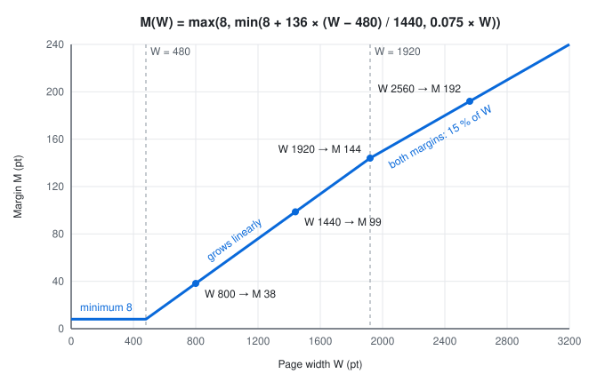
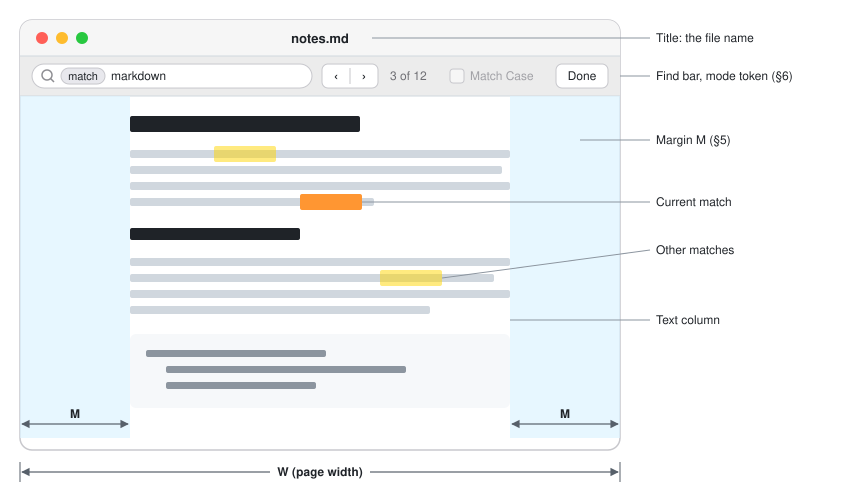
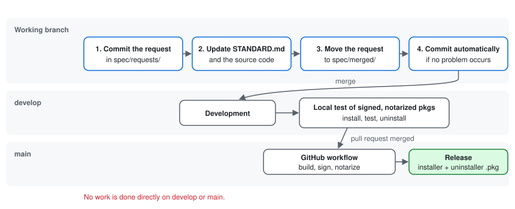

# skon's Markdown Viewer — Standard

## 1. About this document

1. This document is the only specification of skon's Markdown Viewer. If any other document conflicts with it, this document is correct.
2. It contains text and figures that help understanding. Supplementary files are kept in `spec/STANDARD/`.
3. It is written in English only, to avoid confusion between languages.
4. It is updated only through specification requests (§11.3).

## 2. Product

| Item | Value |
|---|---|
| Display name | skon's Markdown Viewer |
| App name | MarkdownViewer |
| Bundle file name | `MarkdownViewer.app` |
| Bundle identifier | `io.github.skonmeme.markdownviewer` |

- "skon" is always written in lowercase, also at the start of a sentence.
- The display name is shown wherever macOS shows the app to users: Finder, Launchpad, the Dock, the menu bar, the About panel and the installer.
- The app name is used for the bundle file and the package files (§10).

### 2.1 App icon

The app icon is an Icon Composer document (`.icon`) in the Liquid Glass icon format of macOS 26 (Figure 1). On its 1024 pt canvas it has four parts:

- **Background**: light gray (automatic gradient `extended-srgb:0.95,0.95,0.97`).
- **Badge**: a rectangle with a semicircle on each end, 880 × 440 pt, centered. It is colorless clear glass (white fill with alpha 0.05, translucency 0.92) with Icon Composer refraction of strength 0.15 and depth 0.1.
- **Mark**: the Markdown mark M↓ without its frame, 520 pt wide, centered on the badge. It is an opaque layer, not glass, and is black in the light appearance and white in the dark appearance.
- **Lettering**: "skon's" in lowercase round strokes drawn for the icon (not set in a font), with a stroke width of 26 pt, deep blue `#0033aa` at 50 % opacity, rising 15° to the right. It is about two thirds of the badge size and placed at the upper left, so that its lower part lies on the upper rim of the badge and is bent by the refraction.


## 3. Target environment

- macOS 26 or later.
- Macs with Apple silicon only.

## 4. Basic viewer features

### 4.1 Documents

- The app opens Markdown files with the extensions `.md`, `.markdown`, `.mdown`, `.mkd`, `.mkdn`, `.mdwn`, `.mdtxt` and `.mdtext`.
- A document can be opened by double-clicking it or using Open With in Finder, by dropping it on the app icon or on a document window, with File > Open…, with File > Open Recent, and by passing its path as a command-line argument to the app's executable.
- Opening a document that is already open brings its window to the front.
- Each document is shown in its own window. Windows can be combined into tabs with the standard macOS window tabs.
- The window title shows the file name.
- When the app is started or activated while no document is open, it shows the Open panel.

### 4.2 Rendering

- Markdown syntax: CommonMark with the GitHub Flavored Markdown extensions (tables, task lists, strikethrough, autolinks), footnotes, and GitHub alerts (`> [!NOTE]`, `> [!TIP]`, `> [!IMPORTANT]`, `> [!WARNING]`, `> [!CAUTION]`).
- Every heading can be the target of a link (`#heading`).
- YAML front matter at the start of a document is not shown as normal text; it is shown as a collapsed block that can be expanded.
- Fenced code blocks that name a language are syntax highlighted.
- HTML inside a document is displayed. Scripts in a document never run.
- Images given by a relative path, an absolute path or an `http`/`https` URL are displayed.
- The look of the page follows GitHub's Markdown style.

### 4.3 Links

- A link to an anchor in the same document scrolls to its target.
- A link to another Markdown file opens that file in the app. A link to any other local file opens it with its default application.
- Any other link (`http`, `https`, `mailto`, …) opens with the default application.

### 4.4 Live reload

- When the file of an open document changes on disk, the document is updated automatically and keeps its scroll position. Editors that save by replacing the file are supported.
- If the file is deleted, the last content stays on screen.

### 4.5 Other features

- Zoom: View > Zoom In, Zoom Out and Actual Size change the size of the page between 50 % and 300 %.
- Printing: File > Print… prints the document. Printed pages always use dark text on a white background.
- Text in a document can be selected and copied.
- The page follows the light or dark appearance of macOS unless custom colors are chosen (§8).

## 5. Margins

The page shows the document text between a left and a right margin of the same width (Figure 3).

### 5.1 Automatic margins

Automatic margins are the default. The margin `M` depends on the width `W` of the page, both in points at 100 % zoom:

```
M(W) = max(16, 16 + 0.35 × (W − 560))
```

A narrow page (up to 560 pt wide) keeps a margin of 16 pt. Beyond that, 35 % of the extra width is added to each margin, so a wide window gets relatively generous margins (Figure 2).

| Page width `W` | Margin `M` | Text width |
|---:|---:|---:|
| 480 | 16 | 448 |
| 800 | 100 | 600 |
| 1024 | 178 | 667 |
| 1440 | 324 | 792 |
| 1920 | 492 | 936 |



### 5.2 Manual margins

- The user can replace the automatic margin with a fixed margin between 0 and 480 pt (§9.1).
- A fixed margin is never larger than 25 % of the page width, so the text always keeps at least half of the width.
- View > Increase Margins (⌥⌘+) and View > Decrease Margins (⌥⌘−) change the margin by 16 pt, starting from the margin currently shown, and switch to a fixed margin. View > Automatic Margins (⌥⌘0) switches back to automatic margins.

## 6. Search



- Edit > Find > Find… (⌘F) shows the find bar at the top of the window (Figure 3). It contains a search field, Previous and Next buttons, a match counter, a Match Case option and a Done button.
- Searching starts while the user types. The query is matched as literal text, ignoring case unless Match Case is on.
- A match can cover text with different styles inside one block, but never text from different blocks (paragraphs, list items, table cells, …). A space in the query matches any white space.
- All matches are highlighted. The current match is highlighted in a stronger color and scrolled into view. A match inside a collapsed section opens that section.
- The counter shows the position of the current match and the number of matches ("3 of 12"), or "Not found".
- Return and ⌘G go to the next match; Shift-Return and ⇧⌘G go to the previous match. The search wraps around at the end and the start of the document.
- Edit > Find > Use Selection for Find (⌘E) searches for the selected text.
- Esc and Done close the find bar and remove the highlights. The current match becomes the text selection.
- If the document is reloaded (§4.4) while the find bar is open, the search is repeated on the new content.

## 7. Fonts

### 7.1 Latin and Korean fonts

- Korean text and Latin text use separately chosen fonts.
- The Korean font is used for Hangul: the Unicode blocks Hangul Jamo (U+1100–U+11FF), Hangul Compatibility Jamo (U+3130–U+318F), Hangul Jamo Extended-A (U+A960–U+A97F), Hangul Syllables (U+AC00–U+D7AF), Hangul Jamo Extended-B (U+D7B0–U+D7FF) and the halfwidth Hangul forms (U+FFA0–U+FFDC).
- The Latin font is used for English text and for every other character that is not Hangul.
- Code uses a monospaced font. Hangul in code uses the monospaced font if that font contains Hangul, and the Korean font otherwise.

### 7.2 Font sets

- A font set is a named combination of a Latin font, a Korean font, a monospaced font, a font size (8–48 pt) and a line height (1.0–2.5 times the font size).
- The built-in font set "Default" is always available. It uses the system font for Latin text, Apple SD Gothic Neo for Korean text and the system monospaced font for code, with a font size of 16 pt and a line height of 1.6. It cannot be edited, renamed or deleted.
- The user can add a font set (a copy of the active one), edit it, rename it, delete it and choose the active font set.
- Font set names are unique, ignoring case. "Default" is reserved for the built-in font set.
- Each font list offers "System Font" and the installed font families. The Korean list contains only families that include Hangul; the monospaced list contains only fixed-pitch families.

## 8. Colors

- **Automatic** (default): the colors follow the macOS appearance — dark text on a light background in Light mode, light text on a dark background in Dark mode.
- **Custom**: the user chooses the text color and the background color. They are used in both appearances.
- The other colors of the page (links, borders, code backgrounds, syntax highlighting) are derived from the text and background colors so that they stay readable. A background counts as dark when its relative luminance is below 0.18.

## 9. Settings and menus

### 9.1 Settings window

App menu > Settings… (⌘,) opens the Settings window with three groups:

- Fonts: font set, Latin font, Korean font, monospaced font, font size, line height (§7).
- Colors: Automatic or Custom, text color, background color (§8).
- Margins: Automatic or Fixed, fixed margin (§5).

Changes apply immediately to every open document and are kept after the app quits. The zoom level (§4.5) is also shared by all windows and kept.

### 9.2 Menus and keyboard shortcuts

| Menu | Items |
|---|---|
| skon's Markdown Viewer | About skon's Markdown Viewer · Settings… ⌘, · Services · Hide skon's Markdown Viewer ⌘H · Hide Others ⌥⌘H · Show All · Quit skon's Markdown Viewer ⌘Q |
| File | Open… ⌘O · Open Recent · Close ⌘W · Reload ⌘R · Page Setup… ⇧⌘P · Print… ⌘P |
| Edit | Undo ⌘Z · Redo ⇧⌘Z · Cut ⌘X · Copy ⌘C · Paste ⌘V · Select All ⌘A · Find (Find… ⌘F · Find Next ⌘G · Find Previous ⇧⌘G · Use Selection for Find ⌘E) |
| View | Actual Size ⌘0 · Zoom In ⌘+ · Zoom Out ⌘− · Increase Margins ⌥⌘+ · Decrease Margins ⌥⌘− · Automatic Margins ⌥⌘0 · Enter Full Screen ⌃⌘F |
| Window | Minimize ⌘M · Zoom · Bring All to Front |
| Help | skon's Markdown Viewer Help |

Reload (⌘R) reads the file again even when no change was detected.

Help > skon's Markdown Viewer Help opens the usage guide in a viewer window. The usage guide is a Markdown document bundled with the app that explains only how to use the app. It exists in Korean and in English; the version matching the system language is shown, and English is shown for any other system language.

## 10. Installation and removal

- The app is installed with the installer package `MarkdownViewer-<version>.pkg`. It installs `MarkdownViewer.app` into `/Applications`, where it is available to all users of the Mac.
- The installer refuses to install on Macs without Apple silicon and on macOS versions earlier than 26.
- The app is removed with the uninstaller package `MarkdownViewer-uninstaller-<version>.pkg`. It quits and deletes the app. It also offers to delete the settings and caches of the user who runs it; this option is selected by default.
- The app is signed with a Developer ID Application certificate and the hardened runtime. Both packages are signed with a Developer ID Installer certificate, notarized by Apple and stapled. Unsigned or unnotarized packages are never released.

## 11. Development

### 11.1 Language

The app is written in Rust. Swift may be used together with Rust only where it is really necessary.

### 11.2 Documents

| Path | Content | Language |
|---|---|---|
| `spec/STANDARD.md` | This specification | English |
| `spec/STANDARD/` | Supplementary files of this specification | English |
| `spec/requests/` | Specification requests that have not been applied yet | Any |
| `spec/merged/` | Applied specification requests | Any |
| `README.md` | Concise installation and usage guide | Korean |
| `doc/ARCHITECTURE.md` | Detailed explanation of how the app works, with figures and videos; supplementary files are kept in `doc/ARCHITECTURE/` | Korean |
| `doc/DEVELOPMENT/` | Topics to discuss during development, one file per topic; a file is deleted when its topic is resolved | Korean |

Documents in `doc/` are written in Korean unless there is a particular reason not to.

### 11.3 Specification requests



1. This document is updated only through specification requests, which are written in `spec/requests/`.
2. No work is done on the `main` and `develop` branches. Work is always done on the branch where the specification request is committed.
3. While this document is updated, the source code is created or changed so that it matches this document.
4. After this document has been updated, the specification request is moved to `spec/merged/`.
5. If no problem occurs during the process, the changes are committed automatically on the working branch.

### 11.4 Branches and releases

- Development takes place on the `develop` branch.
- Before a release, the packages are tested locally:
  1. Signed and notarized installer and uninstaller packages are built on the developer's Mac. Signing uses the Developer ID certificates in the keychain; notarization uses notarytool credentials stored in the keychain.
  2. The installer package installs the app into `/Applications`, where its features are checked and Gatekeeper must accept it.
  3. The uninstaller package must remove it completely.
- When a pull request is merged into `main`, the GitHub workflow builds, signs and notarizes the app and both packages and publishes a release that contains the two packages (§10). It uses the same certificates as the local build, read from these repository secrets:

| Secret | Content |
|---|---|
| `DEVELOPER_ID_P12` | Base64 of a `.p12` file with the Developer ID Application and Developer ID Installer identities |
| `DEVELOPER_ID_P12_PASSWORD` | Password of that `.p12` file |
| `NOTARY_ISSUER_ID` | Issuer ID of the App Store Connect API key used for notarization |
| `NOTARY_KEY_ID` | Key ID of that API key |
| `NOTARY_KEY` | Private key (`.p8` contents) of that API key |
